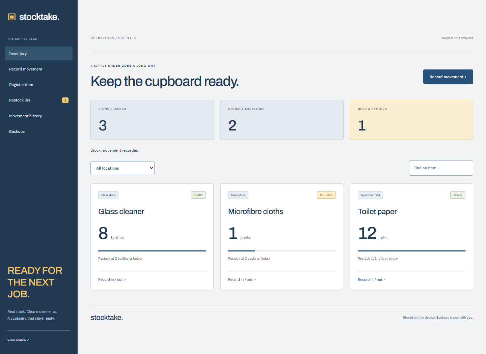

# Stocktake

A small supply desk for cleaning consumables and other stock kept across several locations. Record what arrived, what was used, and what needs to be bought before the next job.

[Open the application](https://goshkaaaa.github.io/stocktake/) · [Mobile screenshot](docs/mobile.png)



## What works

Register items by storage location, choose their unit and minimum level, and record stock-in or stock-out movements. Balances come from the movement history, rather than a number that can be silently overwritten. Withdrawals cannot take a balance below zero. The same item can exist at several locations, but duplicate item/location pairs are rejected.

Search inventory, filter by location, review movements, and export or print the restock list. Suggestions target twice the minimum level, with at least one unit ordered for an item at its threshold. No example stock is created; new items start at zero until a delivery is recorded.

## Run and verify

Use Node.js 24 LTS.

```sh
npm ci
npm run dev
npm run lint
npm test
npx playwright install chromium
npm run test:e2e
npm run build
npm run preview
```

React, JavaScript, Vite, and IndexedDB through `idb`. Builds go to `dist/`; GitHub Pages builds use the `/stocktake/` base path.

## Storage and scope

The inventory and movement log live in this browser. Mutations use read/write transactions against the latest saved state; open tabs refresh through BroadcastChannel. JSON backups include the full history. Restore requires an explicit replacement choice and validates balances and references before committing; an in-session undo is available. CSV exports escape cells and neutralise formula-like values.

This is a single-device operations tool, not a shared warehouse server. There are no accounts, cloud sync, purchases, supplier integrations, or automatic orders. Units are whole pieces, bottles, packs, and rolls; fractional materials are outside this version's scope. Stock history is append-only. To correct a quantity, enter an opposite movement with an explanatory note.

Limits: 1,000 items, 20,000 movements, 1,000,000 units per balance, and 10 MB backup imports. Back up important records before clearing browser storage or moving devices. The restock quantity is a simple threshold-based suggestion, not demand forecasting.

Tests cover balance calculation, overspending prevention, numeric input, duplicate inventory, restock suggestions, invalid backups, and CSV. Browser checks exercise delivery, usage, persistence, restock output, empty startup, downloads, mobile layout, and accessibility. Screenshot entries were entered during QA and are not application seed data.

Optional Google Fonts have local fallbacks. MIT license.
